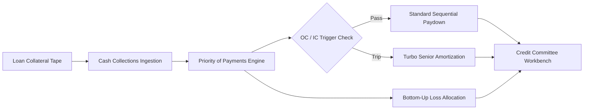

# S&P Global Ratings Structured Finance Cash-Flow Waterfall AI Engine (Waterfall-Net)

An institutional-grade cash-flow waterfall modeling, loan tape surveillance, and tranche credit risk engine designed for S&P Global Ratings Structured Finance & Credit Surveillance.

## System Architecture



## Key Capabilities
- **Priority of Payments Waterfall:** Vectorized simulation of monthly fee distributions, sequential note interest, principal amortizations, and equity distributions.
- **Dynamic Structural Triggers:** Automated monitoring of Overcollateralization (OC) and Interest Coverage (IC) tests with automated cash-sweep redirection.
- **Bottom-Up Loss Absorption:** Evaluates tranche loss breakevens by routing collateral write-downs through equity and mezzanine tranches first.
- **Interactive Credit Surveillance Portal:** Streamlit application for stress-testing deal structures under custom default and prepayment curves.

## Core Modules
- `src/core_engine.py`: DebtTranche data structures, OC calculations, and monthly payment waterfalls.
- `app/streamlit_app.py`: Streamlit credit committee workbench.
- `tests/test_core.py`: Comprehensive test suite verifying sequential paydowns, loss allocation, and OC test triggers.

## Quickstart
```bash
pip install -r requirements.txt
python -m pytest tests/ -v
streamlit run app/streamlit_app.py
```

## Author
Bhupesh Chandra Dimri (bhupeshcdimri21@gmail.com)  
M.S. in Accounting Analytics & Data Technology, Pace University  
Bloomberg BMC & BFF Certified • Oracle Cloud ERP Certified
